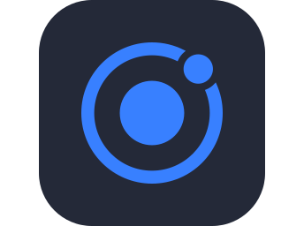

<!-- Header -->
<p align="center">
  
</p>

<p align="center">
  <a href="https://git.io/typing-svg">
    
  </a>
</p>

<p align="center">
  <a href="https://fb.com/voducmanh.kai"></a>
  <a href="https://linkedin.com/in/i-m-kai-8976251b4"></a>
  <a href="https://instagram.com/voducmanh99"></a>
  <a href="https://twitter.com/voducmanh1999"></a>
  
</p>

---

###  About me

```js
const kai = {
  role: "Frontend Developer",
  location: "Vietnam 🇻🇳",
  stack: ["React", "Vue", "Angular", "Ionic", "TypeScript"],
  currently: "Shipping fast, clean & responsive interfaces",
  funFact: "I design in Figma before I code 🎨",
};
```

### 🛠️ Tech stack

<p align="center">
  <br/>
  <br/>
  
</p>

### 📊 GitHub stats

<p align="center">
  
</p>

<p align="center">
  
  
</p>

<p align="center">
  
</p>

### ☕ Support

<p align="center">
  <a href="https://www.buymeacoffee.com/voducmanh99"></a>
</p>

<!-- Footer -->
<p align="center">
  
</p>

<!-- Thanks for visiting! -->
